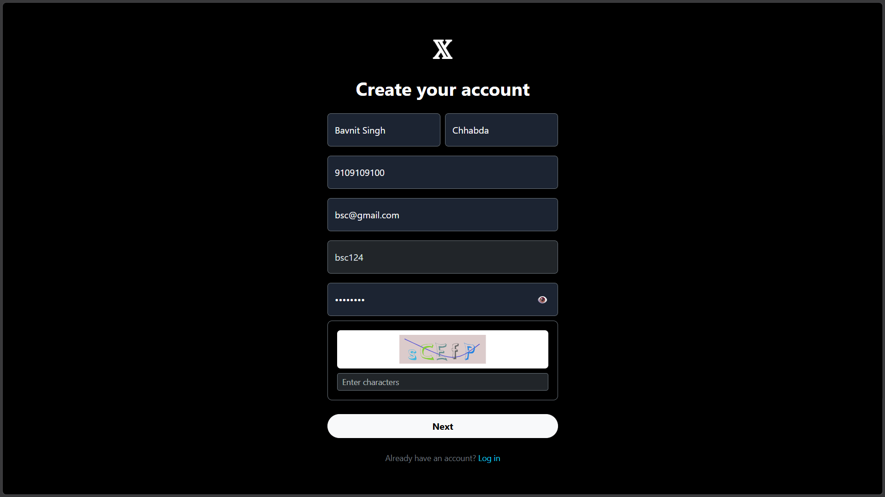
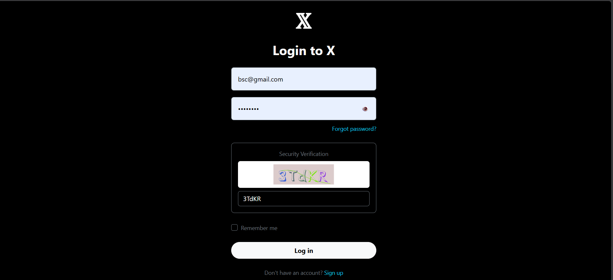
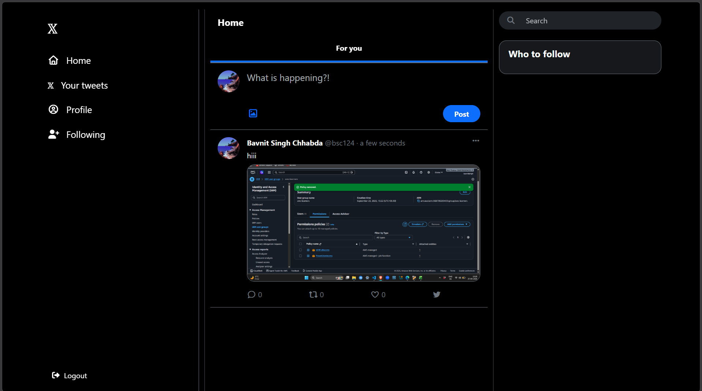
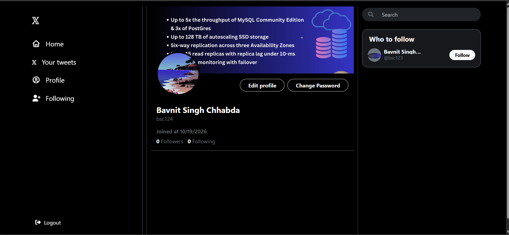
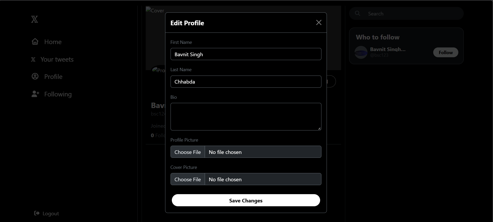
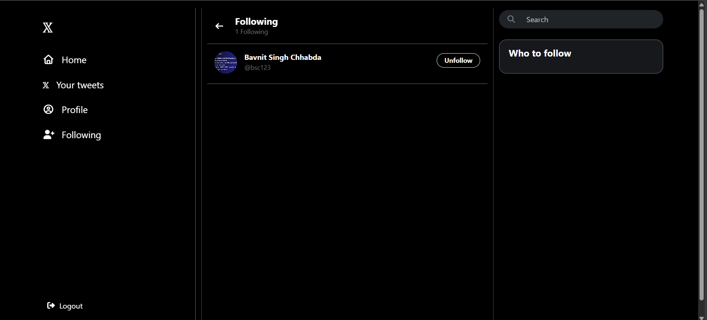
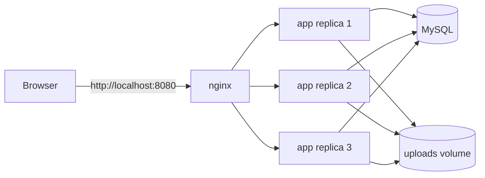
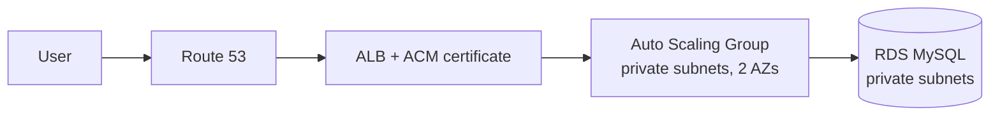

# Twitter Clone: Dockerised app, rebuilt for AWS with Terraform

A Twitter-style social app (Node.js / TypeScript / Express) that I am packaging for horizontal scaling and rebuilding on AWS with Terraform.

> **Status: work in progress.** The app and its local multi-replica setup work. The AWS infrastructure is being built phase by phase (see [Roadmap](#roadmap)). Anything marked *planned* does not exist yet.


 

 

 

 





 

## What the app does

- Sign up and log in with a captcha, JWT cookie authentication (Passport)
- OTP verification, forgot / reset password, change password
- Tweets with media, likes, comments, retweets
- Follow / unfollow, people recommendations, search
- Profile and cover pictures

**Stack:** Node.js 24, TypeScript, Express, EJS views, MySQL 8.4, nginx, Docker Compose.

## Architecture

### Today (local)



nginx distributes requests round-robin across three identical app containers, so the app has to be stateless to work. That is deliberate: it is the local rehearsal for an Auto Scaling Group.

### Target on AWS (planned)



Planned services: VPC (public, private-app and private-db subnets across 2 AZs), ALB, EC2 Auto Scaling Group, RDS MySQL, ECR, Route 53, ACM, IAM roles with least privilege, Secrets Manager / SSM, CloudWatch and SNS alarms, remote Terraform state, GitHub Actions CI/CD. Shared file storage for uploads is still to be decided.

The infrastructure is meant to be built, demonstrated, and destroyed with `terraform destroy` to keep cost down.

## Run it locally

**Requirements:** Docker with Compose v2.

```bash
cd app/docker
cp .env.example .env
cp .env.db.example .env.db
# edit both files: set secrets, and keep DB_NAME / DB_USER / DB_PASSWORD
# in .env identical to MYSQL_DATABASE / MYSQL_USER / MYSQL_PASSWORD in .env.db

docker compose up --build -d
docker compose ps          # expect 1 db, 1 nginx, 3 app, all healthy
```

Open **http://localhost:8080**.

The app container runs with `NODE_ENV=production`, so it **refuses to start** if a required secret is missing and tells you which one.

| Variable | Purpose |
|---|---|
| `JWT_SECRET` | signs login tokens |
| `OTP_SECRET` | OTP generation (must be base32) |
| `CAPTCHA_SECRET` | signs captcha tokens |
| `DB_HOST` (`db`), `DB_PORT`, `DB_NAME`, `DB_USER`, `DB_PASSWORD` | MySQL connection |
| `SITE_URL` | public URL, used to build links such as password reset |
| `CAPTCHA_TTL_SECONDS` | optional, captcha lifetime (default 120) |
| `SHOW_SERVED_BY` | optional, `true` adds an `X-Served-By` header and request logs for load-balancing demos. Never enable in production. |

Generate secrets with `openssl rand -base64 48`. For `OTP_SECRET`: `head -c 20 /dev/urandom | base32`.

**Stop it:** `docker compose down`. Avoid `-v` unless you want a full reset: it deletes the database and the uploads volume together.

### See requests spread across replicas

Set `SHOW_SERVED_BY=true` in `.env`, rebuild, then:

```bash
docker compose logs -f app
for i in $(seq 1 9); do curl -sI http://localhost:8080/login | grep -i x-served-by; done
```

## Repository layout

```
.
├── app/
│   ├── docker/          Dockerfile, compose.yml, env examples
│   ├── nginx/           nginx image: config, error pages
│   ├── src/             TypeScript source
│   ├── public/          static assets
│   └── schema.sql
├── terraform/           (planned)
├── docs/                design notes
└── README.md
```

## Design decisions

- **Stateless app tier.** Auth is a JWT cookie and the captcha is an HMAC-signed token, so any replica can serve any request. No server-side sessions.
- **Multi-stage image, non-root.** Build tools never reach the runtime image. The container runs as a non-root user.
- **Hardened containers.** Read-only root filesystem, all Linux capabilities dropped, `no-new-privileges`, resource limits.
- **TLS terminates at the load balancer** (planned: ALB + ACM), so nginx and the app speak plain HTTP and no certificates live on instances.
- **nginx reverse proxy.** Real client IP recovery from `X-Forwarded-For`, per-IP rate limiting, static assets served outside the limit, custom error pages.
- **Shallow `/health` endpoint** that does not touch the database, so a database blip cannot make a load balancer mark every instance unhealthy.
- **No secrets in the repo.** Only `.example` env files are committed.

More detail:
- [Challenges I hit while scaling horizontally](docs/architecture-challenges.md)
- [Every Dockerfile, compose and nginx directive explained](docs/DOCKER-NGINX-EXPLAINED.md)

## Roadmap

- [x] App containerised (multi-stage image) with nginx reverse proxy
- [x] Local multi-replica test rig (3 app replicas behind nginx)
- [x] Stateless captcha, so login works across replicas
- [x] Shared uploads volume (local stopgap, single host only)
- [ ] Phase 0: AWS account safety, budget alert, non-root access, tooling
- [ ] Phase 1: Terraform remote state
- [ ] Phase 2: VPC, subnets, gateways, routing
- [ ] Phase 3: security groups and IAM
- [ ] Phase 4: RDS and secrets
- [ ] Phase 5: ECR and remaining app changes
- [ ] Phase 6: launch template, ALB, Auto Scaling Group
- [ ] Phase 7: Route 53 and ACM (HTTPS on my own domain)
- [ ] Phase 8: CloudWatch alarms and SNS
- [ ] Phase 9: CI/CD with GitHub Actions
- [ ] Stretch: Lambda, CloudFront, WAF

## Known limitations

- Uploads use a Docker volume shared by replicas on one host. That does not work across separate servers; multi-server storage is still to be decided.
- A solved captcha token can be replayed until it expires. A stricter nginx rate limit on auth routes is planned.
- Upload handling saves files under their original names (collisions possible) with no size or type limits yet.
- Some state-changing actions (delete tweet, logout) are GET routes and should become POST / DELETE.
- Image tags are not yet pinned by digest.